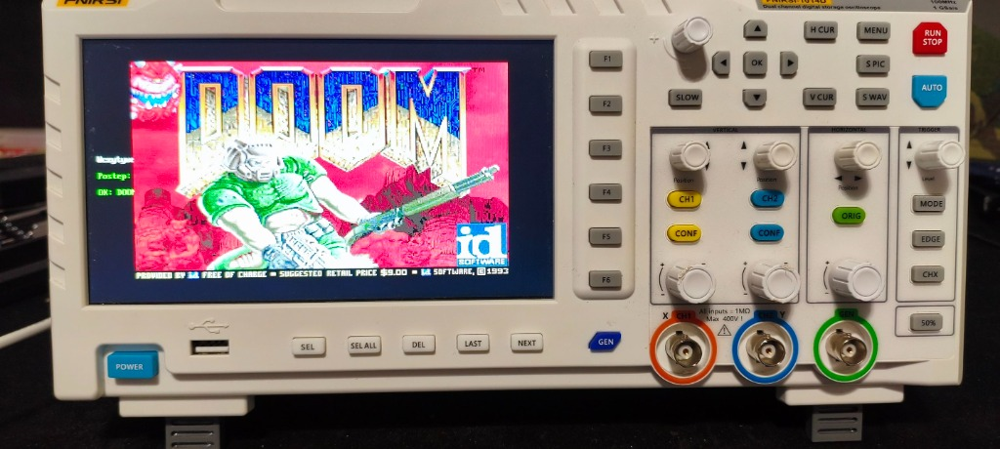
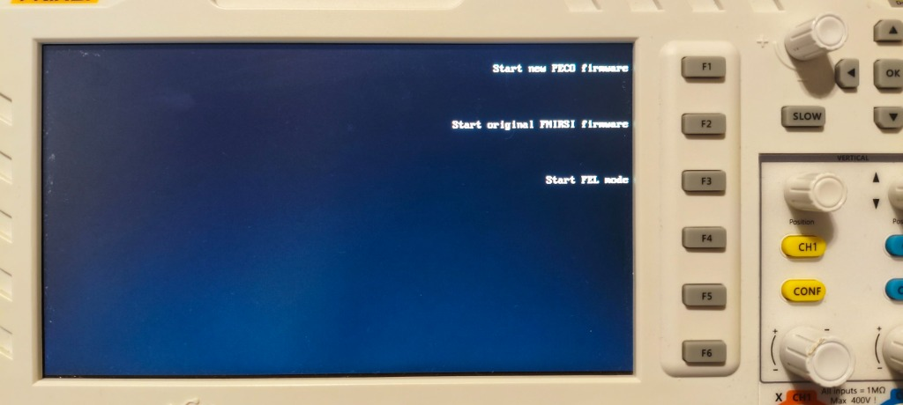
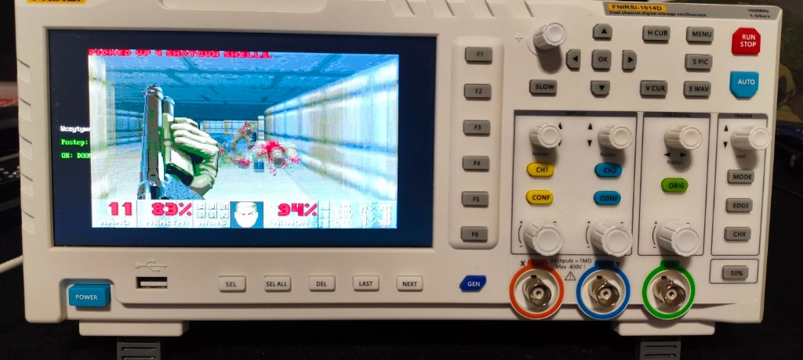

# 👾 DOOM for FNIRSI 1014D Oscilloscope

[](LICENSE)
[-red.svg)]()
[-brightgreen.svg)]()
[]()

A bare-metal port of classic **DOOM** (`doomgeneric`) running on the **FNIRSI 1014D** 2-channel benchtop digital storage oscilloscope.

> [!NOTE]
> **Major Attribution & Thanks:** This port is built directly upon the incredible reverse-engineering work and open-source firmware by **[pecostm32](https://github.com/pecostm32/FNIRSI_1014D_Firmware)**. Without pecostm32's hardware drivers, reverse-engineered register maps, and SD bootloader architecture, running bare-metal software on this oscilloscope would not have been possible.

<p align="center">
  
</p>

---

## ✨ Features

- **⚡ Solid 35 FPS Performance:** Hardware MMU Level-1 translation tables configured with Write-Back L1 Data Cache & Instruction Cache enabled at 600 MHz.
- **🛡️ 100% Safe Dual-Boot:** Never touches or overwrites internal SPI flash! The factory firmware remains completely intact. Swapping back to your original stock MicroSD card or selecting **F2** in the boot menu restores standard oscilloscope operation.
- **🎛️ Full Front-Panel Controls:** All front-panel push-buttons and rotary encoders (knobs) mapped for smooth movement, turning, and weapon firing via the onboard GD32 MCU UART interface.
- **📺 800×480 TFT LCD Display:** Scaled and centered 640×400 RGB565 rendering directly via the F1C100s display engine.
- **💾 Live WAD Loader:** Chunked 32 KB streaming from FAT32 MicroSD with on-screen graphical progress indicator.

---

## 📺 Boot Menu & Starting DOOM

When the oscilloscope powers on with the prepared MicroSD card inserted, the dual-boot selector screen will appear:

<p align="center">
  
</p>

### Select your option using the F1 – F3 buttons (located right next to the screen):
- **🔘 [F1] Start new PECO firmware** — **Launches DOOM!** Loads the WAD file into RAM and launches the game engine.
- **🔘 [F2] Start original FNIRSI firmware** — Boots the original factory oscilloscope software from internal SPI flash.
- **🔘 [F3] Start FEL mode** — Puts the Allwinner SoC into low-level USB FEL flashing/recovery mode.

> [!TIP]
> After pressing **F1**, the loader will mount the SD card, display a live reading progress bar for `DOOM1.WAD`, and then immediately transition to the DOOM title screen!

---

## 📸 In-Game Screenshots

| Title Screen | Gameplay |
| :---: | :---: |
|  |  |

---

## 🕹️ Controls

> [!TIP]
> **Movement & Rotary Encoders (Important):**
> Pressing or holding any directional button registers as a single discrete step or turn point per press. To walk, strafe, and look around smoothly without having to repeatedly mash buttons, **use the rotary encoder dials (knobs)**:
> - **Horizontal TIME Dial:** Rotate for smooth, continuous walking forward and backward.
> - **Vertical CH1 Dial:** Rotate for smooth, continuous strafing left and right.
> - **Navigation (V0 / SEL) Dial:** Rotate for smooth, continuous 360° turning.

| Oscilloscope Control | DOOM Action | Description |
| :--- | :--- | :--- |
| **Directional Buttons** (Up / Down) | Move Forward / Backward | Single step forward / backward (tap) |
| **Directional Buttons** (Left / Right) | Turn Left / Right | Single turn point left / right (tap) |
| **Horizontal TIME Dial** (Rotate) | Walk Forward / Backward | **Smooth continuous walking** |
| **Vertical CH1 Dial** (Rotate) | Strafe Left / Right | **Smooth continuous strafing** |
| **Navigation Dial (V0 / SEL)** (Rotate) | Turn Left / Right | **Smooth continuous turning** |
| **Center OK Button** | **Enter** (Select / Menu OK) | Confirm / Select in menu |
| **MENU Button** | **Escape** (Pause / Game Menu) | Game menu / Pause / Escape |
| **RUN / STOP** | **Primary Fire** (Ctrl) | Primary fire |
| **AUTO** | **Use / Open Doors** (Space) | Open doors / Activate switches |
| **CH1 Enable** | Strafe Left | Single step strafe left (tap) |
| **CH2 Enable** | Strafe Right | Single step strafe right (tap) |
| **F1 – F6** (Under screen) | Weapons 1 to 6 | Direct weapon select (Fist, Pistol, Shotgun...) |

---

## 🚀 Quick Start (Pre-Built Binaries)

You do **not** need to compile anything to play! All pre-compiled binaries and one-click flashers are included in [`prebuilt/`](prebuilt/).

### Requirements:
- **A spare MicroSD card** (any capacity from 512 MB up to 32 GB), formatted with an MBR partition table and a **FAT32** filesystem.

> [!TIP]
> **Strongly Recommended:** Use a **separate, spare MicroSD card** for DOOM rather than modifying the original card that came inside the oscilloscope. Keeping the original stock MicroSD card untouched ensures you always have a completely safe, plug-and-play factory backup. While you can reflash your original stock card (and the flasher script copies the stock firmware backup to it), using a second card eliminates all risk.

---

### Flashing the MicroSD Card (Windows PowerShell):

1. Insert your MicroSD card into your PC.
2. Open **PowerShell as Administrator**.
3. Run:
   ```powershell
   powershell -ExecutionPolicy Bypass -File "prebuilt\flash_sd_card.ps1"
   ```
4. The script will automatically:
   - Detect your MicroSD card.
   - Download the official shareware `DOOM1.WAD` if missing.
   - Copy `DOOM1.WAD` and the scope backup to the FAT32 partition.
   - Flash the bootloader and Doom payload to sector 16 (offset 8192 bytes).
5. Safely eject the card, insert it into the FNIRSI 1014D, power on the scope, and press **F1**!

---

## 🔨 Building from Source (Windows)

All ready-to-play binaries are already included in [`prebuilt/`](prebuilt/), so compiling from source is completely optional. If you wish to rebuild the binaries yourself on Windows:

### 1. Prerequisites (Windows / WSL):
In Windows PowerShell:
```powershell
wsl sudo apt-get update
wsl sudo apt-get install -y gcc-arm-none-eabi libnewlib-arm-none-eabi make
```

### 2. Compile:
```powershell
wsl make -C src clean
wsl make -C src -j8
```
This produces `fnirsi_doom.bin` (standalone binary) and `fnirsi_1014d.bin`.

### 3. Package:
Run the PowerShell packaging script to generate the combined sector 16 image:
```powershell
powershell -ExecutionPolicy Bypass -File "scripts\package_doom.ps1"
```

---

## 🔄 Reverting to Factory Oscilloscope

> [!WARNING]
> **Do not turn on the oscilloscope with no MicroSD card in the slot!**
> The factory oscilloscope firmware expects a valid MicroSD card to be present. If you power on the device with no card installed, it will display an `SD ERROR`.

To use the device as a standard oscilloscope again:
- **Method 1 (Recommended — If using a second SD card):**
  Power off the oscilloscope, remove the DOOM MicroSD card, insert your untouched **original factory MicroSD card** back into the slot, and power on. It will immediately boot the factory oscilloscope firmware.
- **Method 2 (Using the DOOM MicroSD card):**
  Leave the DOOM card in the slot and turn on the device. When the boot menu appears, press **F2** (**Start original FNIRSI firmware**). The system will boot into the stock firmware from internal SPI flash while keeping the card inserted.

---

## 📜 Credits & Acknowledgments

- **pecostm32** ([github.com/pecostm32/FNIRSI_1014D_Firmware](https://github.com/pecostm32/FNIRSI_1014D_Firmware)):
  Huge respect and gratitude to **pecostm32** for the comprehensive reverse-engineering of the FNIRSI 1014D hardware, creating the open-source firmware framework, and writing the core drivers (Display DEBE controller, FPGA clock synthesizer, SD card interface, and GD32 MCU UART protocol). The safe dual-boot SD card bootloader used in this project originates directly from pecostm32's firmware!
- **ozkl** ([github.com/ozkl/doomgeneric](https://github.com/ozkl/doomgeneric)):
  Creator of the wonderful **doomgeneric** framework that makes porting classic Doom to exotic bare-metal platforms straightforward.
- **id Software**:
  For creating **DOOM** (1993) and open-sourcing the engine for the hacker and maker community to enjoy forever.

Licensed under the **GNU General Public License v2.0** ([GPL-2.0](LICENSE)).
